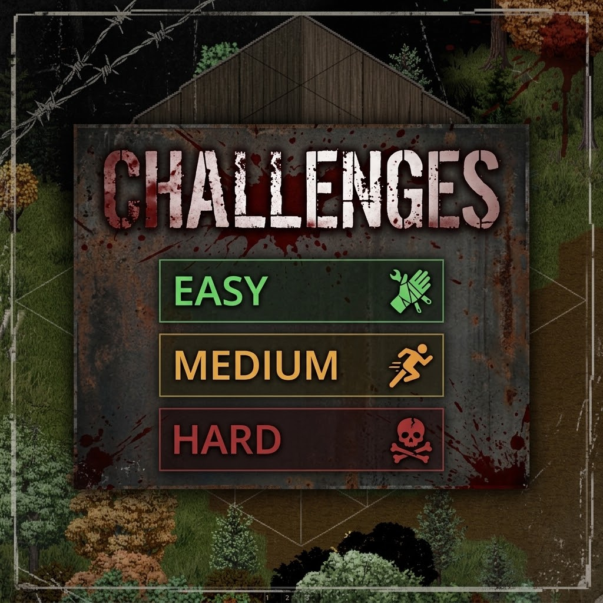
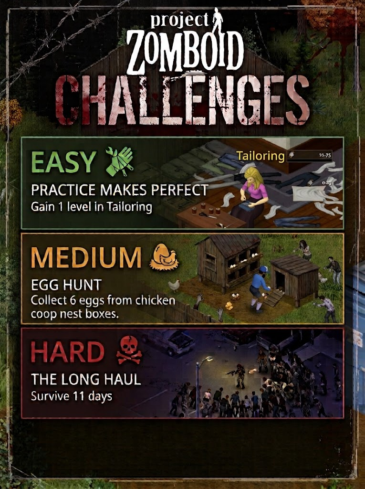

# Challenges (Project Zomboid Build 42)

  
  &nbsp;
  

Take Easy, Medium and Hard challenges, earn score, level up and choose rewards.
Challenges cover combat, survival, deliveries, trips to real buildings, and most
Build 42 activities: animals, trapping, tracking, foraging, fishing, mechanics, welding,
tailoring, pottery, masonry, knapping, glassmaking, electrical work and cooking.

- Open the window with **K** (rebindable in Options > Mods) or from the right-click menu.
- A small tracker next to the moodles shows your level and active challenges.
- Server owners can tune points, level curve, rewards and which challenge types appear
  on the **Challenges** sandbox page.

## Install

Copy this folder into your `Zomboid/mods` folder (it must contain the `42` folder),
then enable **Challenges** in the mod list. Mod id: `VB_Challenges`.

## Changes

See [CHANGELOG.md](CHANGELOG.md) for what changed in each version.

## License

[MIT](LICENSE) © 2026 Carlos Veber. Project Zomboid and its logo and artwork belong to
The Indie Stone; they are not covered by this license.
